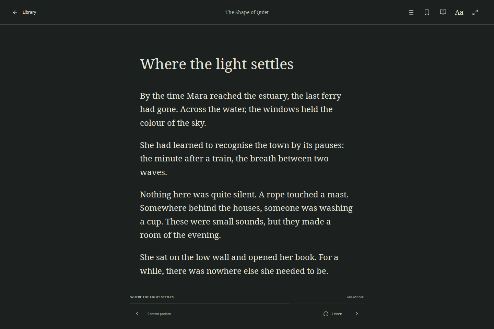
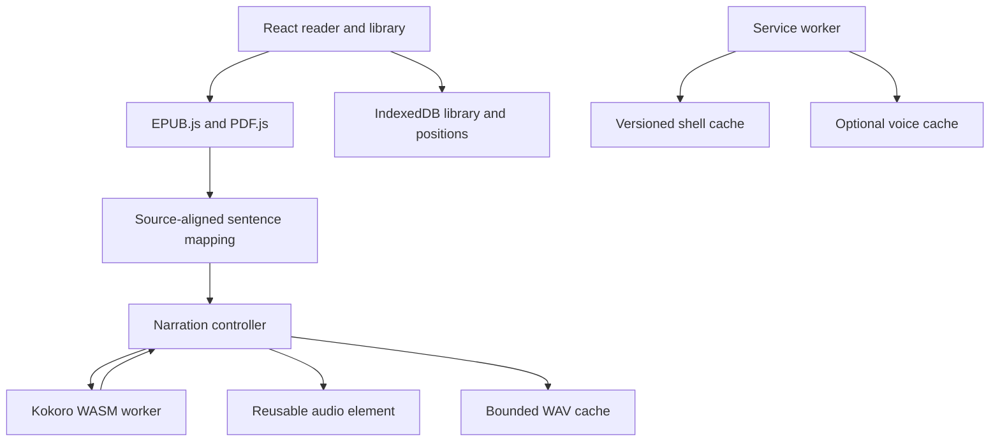

# Hush — Your reading room

A quiet EPUB/PDF reader that runs directly in a desktop or mobile browser, including **real, on-device neural narration**. The primary distribution is a static GitHub Pages site. Reading, storage, text extraction, speech synthesis and playback run on the visitor’s device; no application server, account, paid inference API, Rust installation or desktop helper is required.



> Development build. Browser narration is implemented and has passed real inference/media tests in the production build. See [verification evidence](docs/STATUS.md) for the exact engines and viewports tested. A phone viewport is not a physical iPhone test. A working local build does not establish that a GitHub Pages deployment has succeeded.

## Read and listen

1. Open the hosted reader over HTTPS, or run the local preview below.
2. Import a supported, DRM-free EPUB or text PDF. Three original sample books are available for exploring the reader.
3. Set the theme, typeface, size, line spacing, margins and width. Chapters, bookmarks and reading places are saved automatically.
4. Choose **Listen**. In Settings, select **Enable browser voice** if the voice has not been downloaded. Keep the tab open during setup; Wi-Fi is recommended.
5. After setup, return to the book and choose **Listen**. Pause, previous/next sentence, sentence seeking, speed and volume are available. Narration highlights its sentence and continues into the next chapter.
6. For a PDF, inspect the extracted reading order before starting narration. Layout is preserved on the page; extracted order is not always the intended prose order.

The optional English voice pack is **114,527,513 bytes, about 115 MB decimal**. It includes the quantised Kokoro model, tokenizer, Heart voice and matching ONNX WebAssembly runtime. Opening the reader does not automatically download these voice weights. The initial shell also contains the bundled neural JavaScript/phonemiser code, but does not instantiate the model until requested.

After the shell and voice setup have completed, imported books and browser narration can be reopened offline. Browser storage is local to this site, browser and device. Keep your original books: clearing site data, private browsing or OS storage eviction can remove the library and downloaded voice. This edition does not synchronise libraries between devices.

## Features and boundaries

| Area | Browser edition |
| --- | --- |
| Library | EPUB/PDF import, duplicate detection, search, sorting, editable details and reading/finished filters |
| EPUB | Reflowable chapters, illustrations, table of contents, content anchors and sentence highlights |
| PDF | PDF.js page rendering, selectable text, page/zoom/rotation/scroll restoration and text-order preview |
| Reading | Light, Warm and Night themes; Noto Serif/Sans or publisher fonts; size/spacing/width/margin controls; focus mode |
| Saved state | Bookmarks, semantic reading positions and a separate listening cursor |
| Neural audio | Kokoro q8 + Heart voice, worker-based WASM inference, playback controls, one-clip look-ahead and chapter continuation |
| Offline | Versioned app shell, separately removable voice assets, local originals and bounded generated-audio cache |
| Mobile web | Responsive controls, touch layout, safe areas, installable manifest and reusable media element |
| Deliberate limits | English narration; no DRM removal, scanned-PDF OCR, cloud sync or guaranteed background/lock-screen playback |

Fixed-layout EPUB is rejected rather than treated as a reliable reflowable book. PDF text order, multilingual content and unusual publisher markup require document-specific checks. A browser can suspend a tab or worker when the screen locks; do not treat this as an audiobook app with an OS background-audio entitlement.

## Run locally

Use **Node 24** and the committed npm lockfile:

```bash
npm ci
npm run build
npm start
```

Open **http://127.0.0.1:1420**. The preview server has no separate dependencies. Use localhost or HTTPS: workers, service workers, cryptography and persistent caches need a secure context. Opening `dist/index.html` through `file://` is not supported.

`npm run build` stages the pinned browser voice assets, generates third-party notices, typechecks TypeScript and creates `dist/`. The first build downloads the 92 MB quantised model from its pinned official Hugging Face revision. Later builds verify and reuse the local staged files. Model binaries are excluded from git and included in the static deployment artifact. There is no model download from Hugging Face at reading time: the deployed site serves its own copy.

For development use `npm run dev`. Both build and dev preparation use `scripts/prepare-web-voice.mjs`. The project `.npmrc` skips the Node ONNX CUDA add-on download; the web app uses the WASM runtime, not CUDA. Node-specific optional dependencies may still appear in the install tree. A narrow `sharp@0.35.5` override updates Transformers’ Node image dependency past its upstream libvips/librsvg advisories; Sharp is not shipped in the browser bundle. The EPUB XML-parser override is also retained in the lockfile.

## Deploy to GitHub Pages

1. In repository **Settings → Pages → Build and deployment**, choose **GitHub Actions** as the publishing source. Ensure the account/repository permits Pages hosting; public repositories are the straightforward portfolio path.
2. Push the source to `main`, or run **Deploy Hush reader** from Actions.
3. The workflow installs locked dependencies, stages the pinned model/runtime, runs unit tests, builds for the Pages base path, tests desktop/mobile reading and offline reopening, and runs real browser neural inference before deploying `dist/`.
4. Wait for the build and deploy jobs to succeed. Use the exact site URL returned by the deploy job. A workflow definition or source upload alone is not a live deployment.

`actions/configure-pages` supplies the base path, so fonts, EPUB resources, PDF workers, voice files, service-worker scope and caches work under a project path such as `/hush/`. The UI does not require server-side routes or redirects. The deployment job receives `pages: write` and `id-token: write`; build jobs have read-only repository permissions. The browser release does not build the Tauri host or run a local voice server.

Reproduce the project-path build on Bash:

```bash
HUSH_BASE_PATH=/hush/ npm run build
HUSH_BASE_PATH=/hush/ npm run test:e2e
HUSH_BASE_PATH=/hush/ npm run test:offline
HUSH_BASE_PATH=/hush/ HUSH_TEST_WEB_VOICE=1 npm run test:e2e -- tests/web-voice.spec.ts --workers=1
node scripts/serve-preview.mjs --base /hush/
```

In PowerShell, set `$env:HUSH_BASE_PATH = '/hush/'` and `$env:HUSH_TEST_WEB_VOICE = '1'` before the corresponding commands. Unset the base path when building a desktop installer. The complete static artifact is comfortably below Pages’ 1 GB site limit; no individual model file needs to be checked into git.

See [delivery details](docs/DEPLOYMENT.md) for actual publication status and recovery steps.

## Architecture and rationale



### Why a static, local-first app?

The central product is private long-form reading. A backend would add book uploads, accounts, hosting cost and data ownership questions without being necessary for import, rendering, persistence or synthesis. The File API, IndexedDB, Cache Storage, module workers and WebAssembly provide those capabilities in the browser. GitHub Pages distributes immutable files over HTTPS; it does not execute Python, Rust, Node inference or arbitrary server endpoints.

The optional desktop implementation remains in the repository for installations that need native filesystem storage and the Pocket TTS process. The web release uses browser storage and Kokoro WASM, so both distribution targets share reader controls without requiring the same host runtime.

### Why React, TypeScript, EPUB.js and PDF.js?

React manages the library, reader controls and settings; TypeScript expresses distinct EPUB/PDF locators, reading state and audio contracts. Rendering engines are loaded separately so the library does not instantiate a PDF viewer or EPUB book unnecessarily. EPUB.js supplies reflow, spine navigation and CFI ranges; PDF.js preserves printed pages and exposes selectable text. Hush owns import validation, sanitisation, state, typography, sentence mapping, narration control and error recovery around those engines.

EPUB positions use content-based CFIs plus section/href data. PDFs use page, zoom, rotation and vertical offset. Percentages are display information, not the sole restoration mechanism. Typography changes should not turn a saved position into an obsolete pixel coordinate. Listening has its own sentence identity and source anchor, so reading navigation and audio position can be persisted independently.

### Why Kokoro in the browser instead of Pocket TTS?

Pocket TTS remains the optional Tauri desktop adapter. Its implemented Rust process cannot run inside a GitHub Pages page. Kokoro’s maintained JavaScript integration has a documented browser WASM execution path. The default browser model is q8: the pinned ONNX file is **92,361,116 bytes**, considerably smaller than the model card’s fp32 option.

A dedicated module worker owns one loaded model. The UI stays responsive during inference. The baseline uses **one WASM thread**, which works without cross-origin-isolation headers or SharedArrayBuffer. GitHub Pages does not let a project set arbitrary COOP/COEP headers. WebGPU/fp32 could improve throughput on some devices, but would increase the download and hardware-dependent failure surface; it is not a prerequisite or a claimed acceleration feature here.

Kokoro’s text normalisation/phonemisation is retained. Hush supplies the pinned tokenizer, model and fixed voice locally and overrides the inference boundary to avoid a hidden `resolve/main` voice request. Model configuration, tokenizer files, model, voice and runtime all come from this site at runtime. An oversized model token sequence is rejected instead of silently reading a truncated passage.

### Why separate caches?

| Store | Contents | Lifetime / deletion |
| --- | --- | --- |
| Library IndexedDB | Managed original bytes, book metadata, preferences, locators and bookmarks | Kept until the user removes books or site data is cleared |
| App-shell Cache Storage | HTML, code, CSS, fonts, PDF worker and small voice manifest | Versioned with the build, scoped to the app base path |
| Voice Cache Storage | Verified model, tokenizer, fixed voice and ONNX runtime | Explicit enable/download; removable independently of books |
| Audio IndexedDB | Generated WAV clips and LRU metadata | Disposable: at most 128 MiB / 192 clips / 5 MB per clip |

Voice setup validates a restricted seven-file manifest, exact lengths and SHA-256 digests. Its installed marker is written only after all assets are present. Cancellation leaves completed verified files available for a retry. Cache keys include the app path so one Pages app cannot accidentally clear another Hush installation’s voice cache.

### Why cache exact audio and reuse a player?

The narration controller permits one active clip and one look-ahead request. Browser inference has one computation plus a replaceable queued seek; repeated seeks cannot create an unbounded job queue. An in-flight WASM kernel is not preempted mid-instruction. Cancelled results are ignored, and removing the voice terminates its worker.

Listening checkpoints retain a sentence/source hash, model/runtime/voice fingerprint, clip key, seconds, speed and volume. An in-sentence offset is restored only when the **same cached WAV** is available. If audio was evicted or the engine changed, Hush restarts at the source sentence and explains the adjustment. It does not apply old seconds to a newly generated waveform.

One HTML audio element is activated in a user gesture and reused across clips. This helps mobile autoplay rules; if playback is still refused, the controller enters a paused state with an explicit Play control. Sentence highlighting follows the media `playing` event, not an estimated synthesis timer. Whole-clip look-ahead can still gap if a phone generates speech more slowly than it plays.

## Privacy, security and resource limits

Imports are processed locally. Documents cannot select a model URL, executable, inference endpoint or voice path. EPUB archive inflation and resource counts are bounded, publication scripts/remote resources are sanitised, and the EPUB frame does not enable scripted content. Supported originals are limited to **50 MiB**; EPUB expansion to **256 MiB**, resources to **32 MiB**, archive entries to **5,000**, and PDFs to **2,000 pages**. The reader still assembles a complete source buffer within those limits; it is not an unlimited streaming PDF implementation.

A normal hosted session fetches static app/voice files from its own origin. No narration text is POSTed to a remote service. The host still sees normal static-file requests and network metadata. There is no analytics SDK. Voice and model installation can use substantially more working memory than their file size; low-memory phones can terminate the worker or tab. Exact RAM, battery and thermal guarantees require physical-device measurement.

HTTPS, IndexedDB, Cache Storage, workers, cryptographic hashing and WebAssembly are required for the full browser experience. Private modes and embedded in-app browsers can restrict storage. If setup fails, retry after freeing space/closing other tabs, or remove the voice in Settings and enable it again. Reading does not depend on voice installation.

## Test and verify

```bash
npm run typecheck
npm test
npm run build
npx playwright install --with-deps chromium webkit
npm run test:e2e
npm run test:offline
HUSH_TEST_WEB_VOICE=1 npm run test:e2e -- tests/web-voice.spec.ts --workers=1
HUSH_TEST_WEB_VOICE=1 npm run test:webkit
```

The production browser test generates neural audio using the actual bundled worker/model. It measures non-silent PCM from Hush’s media stream, checks highlighting, pause/speed/seek, reloads with networking disabled, restores the cached listening position, and naturally enters the next EPUB chapter. It also asserts that no HTTP POST or external HTTP origin was used. It does not mock synthesis to establish this result. Unit tests use controlled media only for deterministic state-machine races.

See [STATUS.md](docs/STATUS.md) for executed counts and limitations. Physical speakers/headphones, real iOS/Android hardware, battery/thermal performance and broad publisher/PDF compatibility are distinct checks. No naturalness score, mobile performance benchmark or completed remote deployment is inferred from a successful local browser run.

## Repository map

| Path | Responsibility |
| --- | --- |
| `src/ui/` | Library, reader chrome, appearance and browser voice setup |
| `src/documents/`, `src/readers/` | Validation, sanitisation, text mapping and document rendering |
| `src/domain/`, `src/platform/` | Typed state, locators and browser/native persistence adapters |
| `src/audio/` | Browser model worker, verified setup/cache, bounded clip provider and media-clock controller |
| `scripts/prepare-web-voice.mjs` | Reproducible, pinned static voice artifact preparation |
| `scripts/offline-shell.ts` | Build-scoped app-shell service worker |
| `tests/` | Production browser reading, offline and actual neural-inference flows |
| `docs/` | Architecture, narration, mobile boundaries, acceptance criteria and evidence |
| `crates/`, `src-tauri/`, `vendor/` | Optional native desktop/Pocket TTS implementation |

## Optional desktop edition

The Tauri/Rust host and SQLite/Pocket TTS adapter remain available; they are not used by GitHub Pages. Desktop builds additionally require the Tauri platform prerequisites and Rust toolchain. Historical desktop narration setup and measurements are in [DESKTOP-NARRATION.md](docs/DESKTOP-NARRATION.md). Native Android/iOS packaging is outside this browser release.

## Licences, attribution and source

Hush’s original source retains its [MIT licence](LICENSE). Dependencies retain their own terms. Kokoro.js, Transformers.js, the ONNX model and fixed Heart voice are attributed separately; the model repository declares Apache-2.0. Noto fonts use OFL. The phonemiser’s JavaScript wrapper declares Apache-2.0 and embeds eSpeak NG, whose GPL-3.0-or-later notice is included. The combined browser distribution must preserve these notices and provide the applicable component source; the application’s MIT notice does not replace upstream terms.

`npm run build` collects distribution notices into `THIRD_PARTY_NOTICES.txt`, including the eSpeak licence and source/build links. The browser Settings links to those notices. The unmodified phonemiser source is [version 1.2.1 / commit 6835144](https://github.com/xenova/phonemizer.js/tree/6835144b7ee9043129222549c1ed2f6a27216278); its embedded engine’s source is [eSpeak NG](https://github.com/espeak-ng/espeak-ng). Source and lockfiles for Hush are supplied in this repository. No DRM bypass or voice cloning is provided.

Primary technical references:

- [Kokoro.js usage and WASM backend](https://github.com/hexgrad/kokoro/tree/main/kokoro.js)
- [Pinned ONNX model, quantisations and voice assets](https://huggingface.co/onnx-community/Kokoro-82M-v1.0-ONNX/tree/1939ad2a8e416c0acfeecc08a694d14ef25f2231)
- [ONNX Runtime Web threading and wasmPaths](https://onnxruntime.ai/docs/tutorials/web/env-flags-and-session-options.html)
- [GitHub Pages custom workflows](https://docs.github.com/en/pages/getting-started-with-github-pages/using-custom-workflows-with-github-pages)
